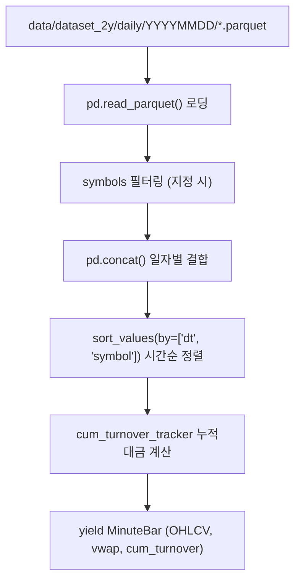

# ⚙️ [엔진 및 미시구조 명세서] Engine & KRX Microstructure Specification

> **Korea Market v3 — Production Infrastructure & Microstructure Mathematics**  
> 본 문서는 Korea Market v3의 체결 엔진, 데이터 피드, 법정 호가 계산식, 리스크 서킷브레이커 및 데이터 모델의 세부 구현 명세와 수학적 공식을 상세히 기록합니다.

---

## 1. KRX 법정 호가 체계 및 호가 반올림 (`core/krx_ticks.py`)

한국거래소(KRX) 유가증권 및 코스닥 시장의 법정 7단계 호가단위(Tick Size) 규약과 부동소수점 오차 없는 호가 정합성을 보장합니다.

```mermaid
flowchart LR
    Price["입력 가격 (float)"] --> TickCalc["get_krx_tick_size()<br/>7단계 법정 호가 매핑"]
    TickCalc --> ModeSwitch{"주문 사이드<br/>(side)"}
    ModeSwitch -->|BUY (기본값: Floor)| FloorMath["Floor 반올림<br/>floor(price / tick) * tick"]
    ModeSwitch -->|SELL (기본값: Ceil)| CeilMath["Ceil 반올림<br/>ceil(price / tick) * tick"]
    FloorMath --> FinalPrice["법정 유효 호가 (int)"]
    CeilMath --> FinalPrice
```

### 1.1 7단계 법정 호가단위 매핑 (`get_krx_tick_size`)
KRX 시장 규정에 따른 가격대별 호가 단위 공식:

$$\text{Tick}(P) = \begin{cases} 
1 \text{ KRW} & (P < 2,000) \\
5 \text{ KRW} & (2,000 \le P < 5,000) \\
10 \text{ KRW} & (5,000 \le P < 20,000) \\
50 \text{ KRW} & (20,000 \le P < 50,000) \\
100 \text{ KRW} & (50,000 \le P < 200,000) \\
500 \text{ KRW} & (200,000 \le P < 500,000) \\
1,000 \text{ KRW} & (P \ge 500,000)
\end{cases}$$

* **설계 의도**: 가격이 경계값(예: 19,990원 $\to$ 20,000원)을 통과할 때 호가단위가 10원에서 50원으로 동적 변경되는 구조를 정확히 반영합니다.

### 1.2 비대칭 호가 반올림 알고리즘 (`round_to_krx_tick`)
국내 증권사(KIS Open API) 주문 전송 시 발생하는 `400 Bad Request: 호가단위 오류`를 원천 방지하기 위해 정수 호가로 변환합니다.

* **기본 모드 결정 규칙**:
  * `side == "BUY"`: 기본값 `"floor"` 강제 (예산 초과 및 추격 매수 방지)
  * `side == "SELL"`: 기본값 `"ceil"` 강제 (지정한 방어선 미만 헐값 매도 방지)
* **수학적 계산식**:
  $$\text{Floor}(P) = \left\lfloor \frac{P}{\text{Tick}(P)} \right\rfloor \times \text{Tick}(P)$$
  $$\text{Ceil}(P) = \left\lceil \frac{P}{\text{Tick}(P)} \right\rceil \times \text{Tick}(P)$$
  $$\text{Round}(P) = \text{round}\left( \frac{P}{\text{Tick}(P)} \right) \times \text{Tick}(P)$$
* **경계 조건 방어**: $P \le 0$일 때 즉시 $0$을 반환하여 `ZeroDivisionError`를 차단합니다.

### 1.3 동적 다중 틱 가감 (`add_krx_ticks`)
단순 $P + (n \times \text{tick})$ 연산 시 호가단위 경계를 넘어가면 호가단위가 달라져 왜곡이 발생합니다.
* **해결 알고리즘**: 매 스텝마다 현재 호가의 `get_krx_tick_size(curr)`를 재산출하여 1틱씩 루프를 돌며 전진/후퇴합니다.
* **하한선 방어**: `max(1, curr - step)`을 통해 가격이 0 이하로 떨어지는 것을 방지합니다.

---

## 2. 비관적 백테스트 체결 엔진 (`engine/broker/backtest.py`)

실전 환경의 호가 공백과 증권사 제비용을 극도로 보수적으로 시뮬레이션하여 과적합을 차단합니다.

### 2.1 제비용 및 슬리피지 기본 파라미터
* **온라인 위탁수수료율**: $c = 0.014\%$ (`commission_rate = 0.00014`, 매수/매도 양방향 부과)
* **증권거래세율**: $\tau = 0.18\%$ (`tax_rate = 0.0018`, 매도 단방향 부과)
* **체결 슬리피지**: $s = 0.035\%$ (`slippage_rate = 0.00035`, 약 1호가 페널티)

### 2.2 체결 가격 산정 공식 (`submit_order`)
* **매수 체결가 ($P_{\text{exec, BUY}}$)**:
  $$P_{\text{exec, BUY}} = \text{round\_to\_krx\_tick}(P_{\text{base}} \times (1 + s), \text{BUY}, \text{"floor"})$$
* **매도 체결가 ($P_{\text{exec, SELL}}$)**:
  $$P_{\text{exec, SELL}} = \text{round\_to\_krx\_tick}(P_{\text{base}} \times (1 - s), \text{SELL}, \text{"ceil"})$$

### 2.3 현금 흐름 및 정밀 손익 회계 (`_fill_order`)
1원의 누수도 없는 완벽한 실전 손익 대사를 위해 매수/매도 수수료를 엄격히 분리 회계합니다:

#### [매수 체결 회계]
$$\text{TradeAmount} = P_{\text{exec}} \times Q$$
$$\text{Commission}_{\text{buy}} = \text{TradeAmount} \times 0.00014$$
$$\text{TotalCost} = \text{TradeAmount} + \text{Commission}_{\text{buy}}$$
$$\text{Cash}_{\text{new}} = \text{Cash}_{\text{prev}} - \text{TotalCost}$$
* 포지션 생성: `avg_price = P_exec`, `high_water_mark = P_exec`, `entry_dt = current_dt`, `phase = 1`

#### [매도/청산 체결 회계]
$$\text{TradeAmount} = P_{\text{exec}} \times Q$$
$$\text{Commission}_{\text{sell}} = \text{TradeAmount} \times 0.00014$$
$$\text{Tax}_{\text{sell}} = \text{TradeAmount} \times 0.0018$$
$$\text{Cash}_{\text{new}} = \text{Cash}_{\text{prev}} + (\text{TradeAmount} - \text{Commission}_{\text{sell}} - \text{Tax}_{\text{sell}})$$
$$\text{GrossPnL} = (P_{\text{exec}} - P_{\text{avg}}) \times Q$$
$$\text{NetPnL} = \text{GrossPnL} - \text{Commission}_{\text{sell}} - \text{Tax}_{\text{sell}} - (P_{\text{avg}} \times Q \times 0.00014)$$

> **[!NOTE] 매수 수수료 소급 차감**  
> `NetPnL` 계산 시 매도 시점의 세금/수수료뿐만 아니라, **진입 당시 이미 납부했던 매수 수수료($P_{\text{avg}} \times Q \times 0.00014$)까지 소급 차감**하여 순수 실현 손익을 계산합니다.

---

## 3. 과거 분봉 데이터 스트리머 (`engine/datafeed/historical.py`)

순수 1분봉(Pure Minute Bars) 데이터셋을 메모리 폭증 없이 시계열로 스트리밍합니다.



* **일자별 디렉토리 격리**: 전체 2개년을 한 번에 메모리에 올리지 않고, `YYYYMMDD` 디렉토리 단위로 로드한 뒤 제너레이터(`yield`)로 스트리밍하여 가비지 컬렉터가 즉시 메모리를 회수합니다.
* **실시간 누적대금 트래커**: 개별 파일에 누적 거래대금이 없더라도 스트리머 내부 딕셔너리(`cum_turnover_tracker[sym]`)가 당일의 1분봉 거래대금을 누적 적산하여 `bar.cum_turnover`에 정확히 주입합니다.

---

## 4. 가상 시계 및 이벤트 스케줄러 (`engine/clock.py`)

* **`IClock` 인터페이스**: `now() -> datetime`, `schedule(trigger_time_str, callback)`
* **`SimulatedClock` (백테스트 가상 시계)**:
  * 인입되는 분봉 타임스탬프(`bar.dt`)에 따라 시간이 전진합니다 (`set_time`).
  * 날짜 변경(`dt.date() != prev_dt.date()`) 감지 시 일일 스케줄러의 실행 플래그(`triggered`)를 자동으로 리셋합니다.
  * 지정된 시각(예: 15:15 타임아웃) 도달 시 등록된 콜백을 단 1회 디스패치합니다.
* **`RealtimeClock` (실전 벽시계)**:
  * OS 시스템 시계(`datetime.now()`)에 직결됩니다.

---

## 5. 계좌 리스크 관리자 (`engine/risk/risk_manager.py`)

전략의 결함이나 급격한 시장 변동성으로 인한 계좌 파산을 원천 차단하는 하드웨어급 방화벽입니다.

* **핵심 서킷브레이커 파라미터**:
  * `max_daily_loss = 500_000.0` (당일 최대 허용 누적 손실 50만 원, 단리 1,000만 원 기준 -5.0%)
  * `max_consecutive_losses = 2` (당일 연속 2회 손실 발생 시 당일 매매 영구 중단)
* **주문 승인 비대칭성 (`validate_order`)**:
  * 서킷브레이커가 발동(`_circuit_broken == True`)되었을 때:
    * 신규 매수(`OrderSide.BUY`): **즉시 거절 (`False`)**
    * 보유 포지션 탈출 매도(`OrderSide.SELL`): **100% 무조건 승인 (`True`)**
  * 리스크 발생 시 신규 위험 노출은 차단하되, 기존 포지션 손절/익절 탈출로는 항상 열어둡니다.
* **손익 피드백 루프 결선**:
  * 브로커에서 `SELL FILLED` 이벤트가 발생할 때마다 `TradingEngine`을 통해 `on_trade_completed(net_pnl)`가 호출되어 당일 실현 손익과 연패 카운트를 실시간 갱신합니다.

---

## 6. 고성능 불변 데이터 모델 (`engine/models.py`)

메모리 절감과 초고속 데이터 순회를 위해 전 모델에 Python `@dataclass(slots=True)`를 적용했습니다.

### 6.1 `slots=True` 도입 효과
* **메모리 60~70% 절감**: 객체당 인스턴스 딕셔너리(`__dict__`) 생성을 원천 차단.
* **속도 30~40% 향상**: 해시 테이블 탐색 대신 고정 C-구조체 오프셋 포인터로 인스턴스 변수에 직접 접근.

### 6.2 핵심 데이터 모델 명세
| 모델명 | 슬롯 필드 (`__slots__`) | 역할 및 특징 |
|---|---|---|
| `MinuteBar` | `symbol`, `dt`, `open`, `high`, `low`, `close`, `volume`, `turnover`, `vwap`, `cum_turnover` | 표준 1분봉 데이터. `time`, `date` 프로퍼티 내장. |
| `TickData` | `symbol`, `dt`, `price`, `volume`, `turnover`, `cum_turnover`, `bid`, `ask` | 실시간 호가/체결 틱 데이터. |
| `EntrySignal` | `symbol`, `dt`, `trigger_price`, `collar_cap_price`, `target_notional`, `reason` | 진입 신호. 호가 캡과 단리 1,000만 원 목표 금액 전달. |
| `ExitSignal` | `symbol`, `dt`, `order_type`, `target_price`, `reason`, `metadata` | 청산 신호. 사유(EMERGENCY_SL, DYNAMIC_SL, TRAILING, TIMEOUT) 기록. |
| `Order` | `order_id`, `symbol`, `side`, `order_type`, `quantity`, `price`, `status`, `tag` | 브로커 전송용 내부 통일 주문 객체. |
| `OrderEvent` | `order_id`, `symbol`, `side`, `status`, `filled_price`, `filled_quantity`, `net_pnl`, `commission`, `tax` | 체결 결과 역방향 이벤트. |
| `Position` | `symbol`, `quantity`, `avg_price`, `high_water_mark`, `phase`, `stop_loss_price`, `trailing_step`, `metadata` | 활성 포지션. 2-Phase 상태 및 스냅샷 보존. |
| `AccountBalance` | `total_equity`, `cash`, `positions` | 계좌 자산 스냅샷 (평가금, 예수금, 포지션 딕셔너리). |
| `TradeRecord` | `trade_id`, `symbol`, `entry_price`, `exit_price`, `quantity`, `gross_pnl`, `net_pnl`, `holding_seconds`, `mfe_pct` | 청산 완료된 거래의 완결 기록 (MFE/MAE 포함). |

---

## 7. 전략 실행 컨텍스트 파사드 (`engine/context.py`)

전략 코드가 브로커나 리스크 매니저의 복잡한 구현체를 직접 알 필요 없도록 감싸주는 **DIP 파사드 브리지**입니다.

* `context.buy(symbol, quantity, price, tag)`:
  * `RiskManager.validate_order()`를 먼저 통과시킨 후 브로커에 주문 제출.
  * 리스크 거절 시 `None`을 반환하여 전략이 슬롯을 소모하지 않도록 방어.
* `context.liquidate(symbol, tag)`:
  * 현재 보유 포지션 전량을 시장가(`OrderType.MARKET`)로 즉시 청산.
* `context.get_position(symbol)` / `context.get_balance()`:
  * 브로커의 현재 상태를 안전하게 조회.

