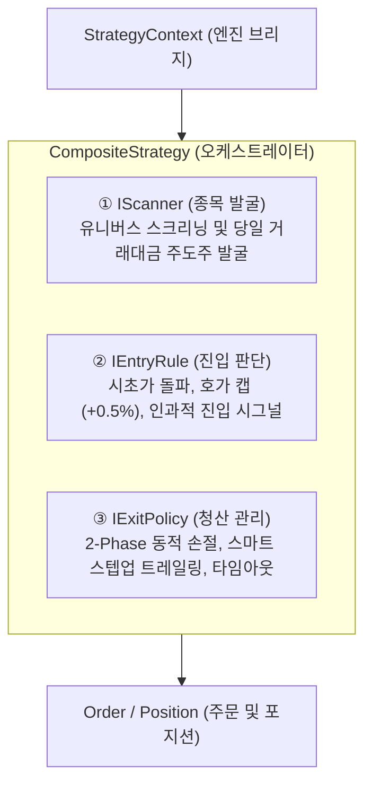
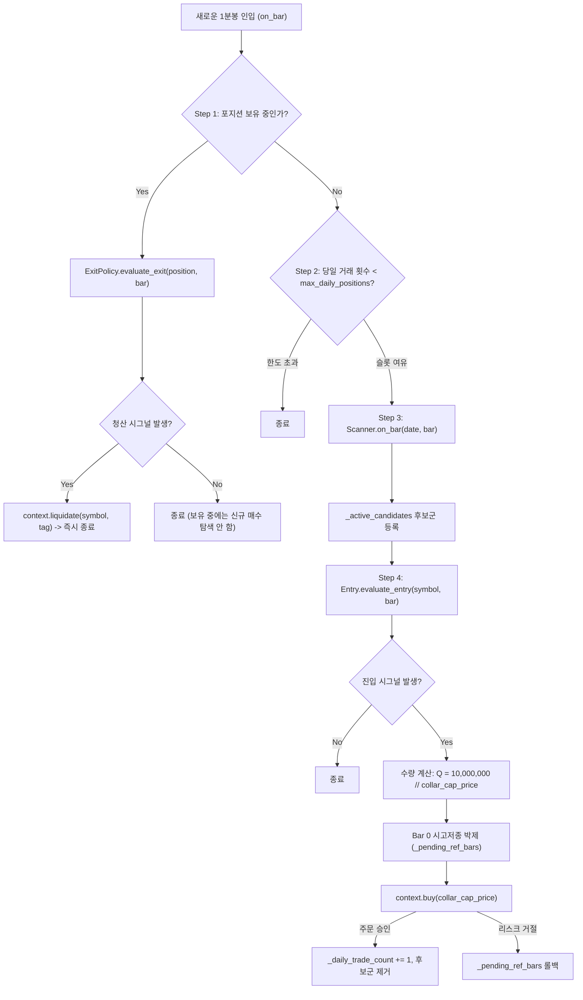
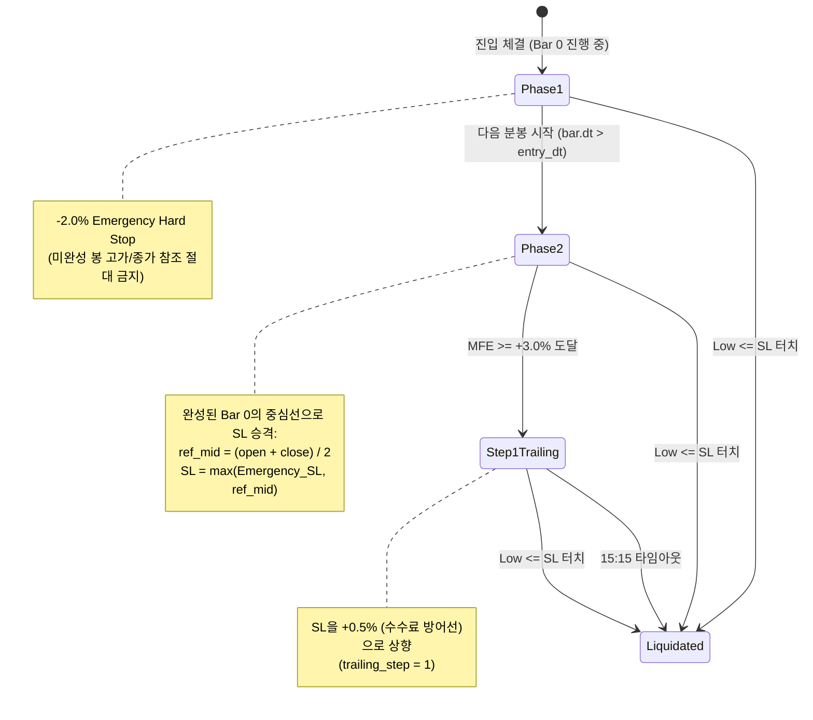

# 🧩 [전략 레고 블록 명세서] Strategy Lego-Blocks Specification

> **Korea Market v3 — Decoupled Quantitative Components**  
> 본 문서는 Korea Market v3의 3대 독립 전략 모듈(스캐너, 진입기, 청산기)의 조립 메커니즘, 2-Phase 수명주기, Bar 0 스냅샷 보존 및 Dual-Bounds 모호봉 처리 알고리즘을 상세히 기록합니다.

---

## 1. 레고 블록 아키텍처 철학 (Lego-Block Architecture)

Korea Market v3는 1,500라인짜리 거대한 단일 전략(Monolith)을 폐기하고, 모든 트레이딩 전략을 **3가지 독립적이고 재사용 가능한 부품**으로 분리하여 조립합니다.



### 3대 컴포넌트의 단일 책임 (Single Responsibility Principle)
| 컴포넌트 | 인터페이스 | 역할 및 책임 | 입력값 | 출력값 |
|---|---|---|---|---|
| **스캐너 (Scanner)** | `IScanner` | 당일 매매 대상 유니버스 스크리닝 및 순위 선정 | 당일 갭, 1분봉 거래대금, 누적대금 | `List[str]` (매매 대상 종목군) |
| **진입 규칙 (Entry)** | `IEntryRule` | 실시간 호가/봉을 감시하며 진입 시점과 목표가 산출 | 현재가, 당일 시가, 체결 거래량 | `Optional[EntrySignal]` (진입 여부, 가격, 캡) |
| **청산 정책 (Exit)** | `IExitPolicy` | 포지션 보유 상태에서 손절, 트레일링 익절, 시간청산 결정 | 포지션 정보, 현재가, 캔들 고/저가 | `Optional[ExitSignal]` (청산 여부, 사유, 목표가) |

---

## 2. 복합 전략 오케스트레이터 (`strategy/composite.py`)

`CompositeStrategy`는 3대 부품을 조립하여 실행하는 중앙 제어기이며, 매 분봉마다 **엄격한 4단계 평가 루프**를 수행합니다:



### 2.1 낙관적 락(Optimistic Lock) 및 롤백 안전망
* **낙관적 락 (Slot Reservation)**: 주문 전송 즉시 `_daily_trade_count += 1`을 올려, 체결 대기(Pending) 중 다음 틱/봉에 의해 중복 매수(Double-order)가 나가는 금융사고를 원천 차단.
* **안전 롤백 (Safety Rollback)**: 만약 브로커나 리스크 매니저에 의해 주문이 거절되거나 취소(`REJECTED`, `CANCELLED`)되면 `on_order_event`에서 `_daily_trade_count = max(0, _daily_trade_count - 1)`로 즉시 슬롯을 반환.

---

## 3. 거래대금 주도주 스캐너 (`strategy/scanners/top_turnover.py`)

장초반(09:00~09:15) 유동성이 급증하는 시장 주도주를 실시간 발굴합니다.

### 3.1 4단계 필터링 알고리즘
```python
# top_turnover.py 내부 평가 로직
1. 시간 게이트: 09:00 <= bar.time <= 09:15
2. MAE 눌림폭: (min(DayLow, bar.low) - DayOpen) / DayOpen >= -0.020 (-2.0% 이내 방어)
3. 양봉 강도 : (bar.close - bar.open) / DayOpen >= +0.015 (+1.5% 이상 실질 양봉)
4. 거래대금   : bar.turnover >= 300,000,000 (1분 3억) and bar.cum_turnover >= 1,000,000,000 (누적 10억)
```

* **수학적 의도**:
  * $\text{BodyPct}$ 계산 시 분모로 `DayOpen`을 채택하여, 갭상승 종목의 변동폭 왜곡을 줄이고 시초가 대비 실질 매수세 유입 강도를 정규화합니다.
  * MAE가 $-2.0\%$를 초과한 종목은 시초가 지지선이 붕괴된 약세주로 판정하여 즉시 배제합니다.

---

## 4. 시초가 돌파 및 호가 캡 진입 (`strategy/entries/breakout_cap.py`)

* **돌파 기준가 ($P_{\text{trigger}}$)**:
  $$P_{\text{trigger}} = \text{round\_to\_krx\_tick}(\text{DayOpen} \times 1.045, \text{BUY}, \text{"ceil"})$$
* **호가 캡 방어선 ($P_{\text{collar}}$)**:
  $$P_{\text{collar}} = \text{round\_to\_krx\_tick}(P_{\text{trigger}} \times 1.005, \text{BUY}, \text{"floor"})$$
* **호가 캡의 역할**:
  * 순간적으로 상한가까지 호가가 튀거나 거래량이 얇은 구간에서 시장가 Sweep으로 평단가가 폭등하는 슬리피지 대참사를 원천 방어합니다.
  * 지정가 주문 가격을 $P_{\text{collar}}$로 제한하여 실전 체결성을 확보합니다.

---

## 5. 2-Phase 수명주기 및 트레일링 청산 (`strategy/exits/two_phase_atr.py`)

미래 참조(Lookahead Bias)를 0%로 차단하고, 이익을 지키는 래칫(Ratchet) 메커니즘입니다.



### 5.1 Bar 0 스냅샷 보존 메커니즘
1. 진입 시점 분봉의 OHLC(`open, high, low, close, dt`)를 `_pending_ref_bars`에 임시 저장.
2. 체결(`OrderStatus.FILLED`) 통보 시 `position.metadata["ref_bar"]`로 영구 이관.
3. 다음 분봉($\text{bar.dt} > \text{entry\_dt}$)이 인입되어 Bar 0가 마감된 순간, `metadata["ref_bar"]`에서 진입봉 시종가를 꺼내어 `(open + close) / 2.0`을 안전하게 계산.

### 5.2 체결 모호성 감사 (Dual-Bounds Resolution)
동일 분봉에서 익절선과 손절선이 동시 터지는 모호봉(Ambiguous Bar) 발생 시:
* **`ambiguity_mode="pessimistic"` (기본값, 실전 하한선)**:
  * 트레일링 상향에 앞서 기존 손절선(`prior_sl`) 터치를 최우선 검사 $\to$ **100% 손절 판정**.
* **`ambiguity_mode="optimistic"` (이론 상한선)**:
  * 고가 도달로 인한 트레일링 승격(+0.5% Lock)을 먼저 처리 후 저가 검사 $\to$ **이익 보존 판정**.

---

## 6. 고정 손익비 청산 (`strategy/exits/fixed_risk_reward.py`)

* **익절선**: $P_{\text{TP}} = \text{round\_to\_krx\_tick}(P_{\text{avg}} \times 1.030, \text{SELL}, \text{"ceil"})$
* **손절선**: $P_{\text{SL}} = \text{round\_to\_krx\_tick}(P_{\text{avg}} \times 0.990, \text{SELL}, \text{"floor"})$
* **모호봉 분기**:
  * 비관적: $P_{\text{SL}}$ 터치 우선 판정 (`HARD_STOP_LOSS`)
  * 낙관적: $P_{\text{TP}}$ 터치 우선 판정 (`TAKE_PROFIT`)

---

## 7. 조립 팩토리 및 레지스트리 (`strategy/registry.py`)

CLI 문자열 인자를 기반으로 레고 블록을 동적으로 인스턴스화합니다:

```python
SCANNERS = {"top_turnover": TopTurnoverScanner}
ENTRIES  = {"breakout_cap": BreakoutCapEntry}
EXITS    = {"two_phase_atr": TwoPhaseAtrExit, "fixed_risk_reward": FixedRiskRewardExit}

def build_strategy(scanner_name, entry_name, exit_name, ambiguity_mode="pessimistic"):
    # 결합 부품 생성 및 CompositeStrategy로 조립 반환
```

