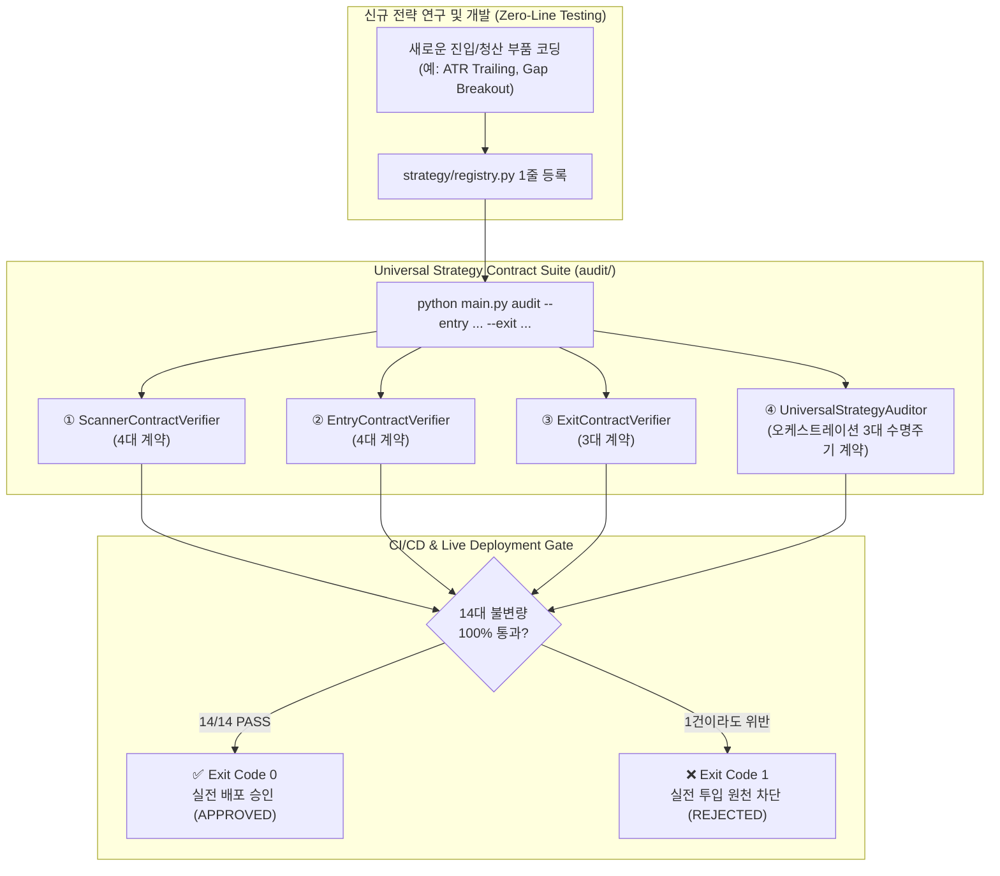
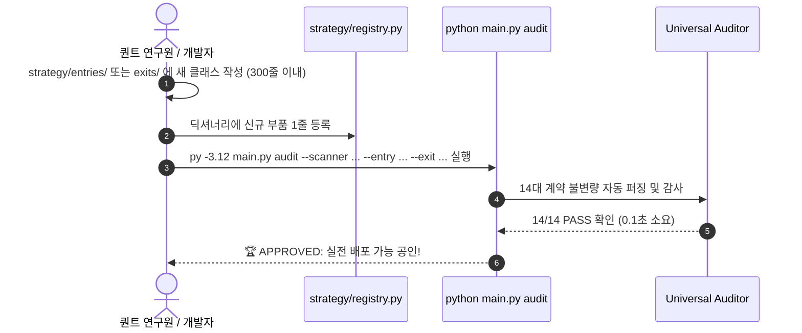

# 🛡️ [범용 전략 계약 감사 하네스] Universal Strategy Contract Suite

> **"전략이 바뀔 때마다 단위 테스트를 매번 새로 작성해야 하는가? 아니다.**  
> **우리는 '개별 전략의 내부 로직'을 테스트하는 것이 아니라, 전략이 시장 및 거래소와 맺은 '불변의 계약(Contract)'을 검증한다.**  
> **Design by Contract(DbC)와 Metamorphic Fuzzing을 결합하여, 단 0줄의 테스트 코드 작성 없이도 모든 신규 전략의 Lookahead 0%, KRX 호가 규격, 래칫 SL 단조성, 모호봉 비관적 방어 등 14대 안전 불변량을 수학적으로 입증한다."**

---

## 1. 배경 및 설계 철학 (Paradigm Shift)

### ① 기존 방식의 한계: 개별 테스트의 유지보수 부채
기존 퀀트 시스템에서는 신규 진입/청산 전략을 만들 때마다 다음과 같은 반복 작업이 발생했습니다:
1. 매번 수십 줄짜리 가짜 분봉 데이터셋과 브로커 이벤트를 수동 모킹.
2. 전략 파라미터가 바뀔 때마다 기존 테스트 코드가 깨지는 회귀 문제.
3. 테스트 작성자의 실수나 편향으로 인해 가장 중요한 **미래 참조(Lookahead)**나 **KRX 호가 단위 위반**, **모호봉 과적합** 검증이 누락.

### ② 해결책: Design by Contract & Metamorphic Fuzzing
Korea Market v3는 **"부품이 바뀌어도 금융 시장의 물리 법칙(호가 단위, 시계열 인과성, 자본 한도)은 절대 변하지 않는다"**는 대원칙에 기반합니다.
- **IScanner, IEntryRule, IExitPolicy**를 어떤 방식으로 구현하든,
- 조립된 **`CompositeStrategy`**는 반드시 충족해야만 하는 **14대 계약 불변량(Invariants)**이 존재합니다.
- `audit/` 패키지는 신규 전략에 변이(Metamorphic), 퍼징(Fuzzing), 극단치 주입(Fault Injection)을 가해 불변 계약 위반 여부를 자동으로 감사(Audit)합니다.



---

## 2. 4대 계약 검증기 아키텍처 및 상세 메커니즘

하네스는 총 4개의 독립 검증기로 구성되어 있으며, 각각 명확한 검증 도메인을 분담합니다:

```
audit/
├── __init__.py                # 공개 API (Scanner/Entry/Exit Verifier, UniversalAuditor, AuditReport)
├── scanner_verifier.py        # [Stage 1] 종목 발굴기 계약 감사 (4대 불변량)
├── entry_verifier.py          # [Stage 2] 진입 규칙 계약 감사 (4대 불변량)
├── exit_verifier.py           # [Stage 3] 청산 정책 계약 감사 (3대 불변량)
└── universal_auditor.py       # [Stage 4] 조립체 수명주기 감사 (3대 불변량) & Rich 리포트 통합
```

---

### [Stage 1] ScannerContractVerifier (`audit/scanner_verifier.py`)

종목 발굴기(`IScanner`)가 미래 시점을 엿보거나 종목 순서에 편향되지 않는지 검증합니다.

1. **Lookahead 0% Metamorphic Fuzzing**:
   - $t=09:02$ 시점에 발굴 기준(거래대금/등락률 등)을 만족한 종목은 미래 봉의 존재 유무와 관계없이 **자율적으로 즉시 선정**되어야 합니다.
   - $t=09:03$ 이후 미래 시점에 극단적인 급등/급락 봉(`turnover=1e11` 등)을 임의 주입(Fuzzing)해도 과거 $t=09:02$의 결정이 번복되거나 흔들리지 않는 시계열 인과 불변성을 입증합니다.
2. **Symbol Permutation Invariance (심볼 셔플 불변성)**:
   - 복수 종목을 처리할 때 인입 순서 $[A, B, C]$와 역순 $[C, B, A]$를 비교합니다.
   - 피드에서 종목이 도착하는 순서가 바뀌어도 최종 후보 종목 집합(`Set[str]`)은 100% 동일해야 합니다 (결정론적 재현성 보장).
3. **Day Reset Idempotence (일자 경계 리셋 및 멱등성)**:
   - 일자가 변경될 때 `on_day_open(day)`을 호출하면 전일의 누적 거래대금이나 후보군 캐시가 100% 소멸되어야 합니다.
   - 연속으로 2회 이상 `on_day_open()`이 호출되어도 시스템이 오작동하지 않는 멱등성을 검증합니다.
4. **Extreme Bar Resilience (극단 이상치 복원력)**:
   - 시가 0원 (0 나누기 공격: `(close - open) / open`), 음수 거래량/거래대금, $10^{15}$원의 천문학적 이상치, 고가 < 저가의 역전봉 인입 시 예외(Unhandled Exception)로 크래시되지 않고 안전하게 처리하는지 퍼징합니다.

---

### [Stage 2] EntryContractVerifier (`audit/entry_verifier.py`)

진입 규칙(`IEntryRule`)이 실전 체결 불가능한 가짜 신호를 내지 않는지 검증합니다.

1. **Bar 0 Ghost Tamper (미완성 봉 고스트 변이 차단)**:
   - **사상 최악의 백테스트 왜곡 방지**: 09:02 봉이 진행 중일 때 고가를 뚫어 진입 신호가 떴다면, 해당 봉의 마감 종가(`close`)가 폭락(-3%)하든 폭등(+5%)하든 진입 트리거 가격(`trigger_price`)과 호가 캡(`collar_cap_price`)은 **단 1원도 변동되어서는 안 됩니다**.
   - 미완성 봉의 마감 종가를 참조하여 진입을 뒤늦게 철회하거나 가격을 조작하는 Lookahead 결함을 원천 적발합니다.
2. **KRX 7-Tier Tick Conformance (KRX 7단계 법정 호가 전수 검증)**:
   - 국내 주식시장의 7대 호가 가격대(2,000원 미만부터 50만 원 이상까지) 전 구간을 주입합니다.
   - 발행된 모든 `trigger_price`와 `collar_cap_price`가 `core.krx_ticks`의 법정 틱 배수(`1원, 5원, 10원, 50원, 100원, 500원, 1,000원`)에 100% 일치하는지 전수 검증하여, 실전 증권사 API의 단수 호가 거부(Order Rejected)를 사전에 차단합니다.
3. **Collar-Cap & Capital Bounds (칼라 캡 슬리피지 방어 및 고정 자본금 한도)**:
   - `collar_cap_price >= trigger_price` 여부와 최대 슬리피지 허용치($\le 1.5\%$)를 검증합니다.
   - 고정 운용 자본금(1,000만 원) 기준 수량 계산 시 (`qty = 10,000,000 // collar_cap_price`), 총 매수 금액이 1,000만 원을 단 1원도 초과하지 않음을 보장합니다.
4. **Single Fire Daily Invariant (일중 단발 발주 보장)**:
   - 동일 종목에 대해 당일 세션 내 단 1회의 진입 신호만 허용합니다.
   - 동일 세션 후속 분봉에서 중복 신호가 발행되는 것을 차단하고, 익일 `on_day_open` 시 정상적으로 슬롯이 리셋되는지 확인합니다.

---

### [Stage 3] ExitContractVerifier (`audit/exit_verifier.py`)

청산 정책(`IExitPolicy`)이 위험을 안정적으로 차단하고 슬리피지를 방어하는지 검증합니다.

1. **Stop-Loss Ratchet Monotonicity (SL 래칫 단조성/후퇴 금지)**:
   - 손절가는 포지션 진입 시점부터 승격(Phase 1 $\to$ Phase 2, 기준봉 중심선, 트레일링 스텝업)될 수만 있으며, **절대로 아래로 후퇴해서는 안 됩니다 ($SL_{t+1} \ge SL_t$)**.
   - 가격이 급등 후 급락하거나 톱니파 노이즈가 발생해도 한 번 확보된 손절선이 견고하게 유지되는지 시계열 궤적을 전수 추적합니다.
2. **Ambiguous Bar Pessimistic Defense (모호봉 비관적 방어 청산)**:
   - 단일 1분봉 내에서 익절 목표가(High)와 손절 마지노선(Low)을 동시에 터치하는 극단 모호봉을 합성 주입합니다.
   - 비관적 체결 모드(`pessimistic`)에서 시스템이 달콤한 익절(`TAKE_PROFIT`)을 취하지 않고, **무조건 손절(`STOP_LOSS`)로 방어 청산**하는지 검증하여 백테스트 과적합 뻥튀기를 완벽 차단합니다.
3. **Hard Timeout 15:15 Invariant (15:15 당일 강제 청산 보장)**:
   - 15:14:00까지는 정상 운용되다가, 15:15:00 정각 인입 시 무조건 시장가(`MARKET`) 청산 주문을 발행해야 합니다.
   - 오버나잇 갭하락 위험을 0%로 만들기 위한 당일 청산 원칙을 강제합니다.

---

### [Stage 4] UniversalStrategyAuditor (`audit/universal_auditor.py`)

3대 부품이 `CompositeStrategy`로 조립되어 브로커/컨텍스트와 상호작용하는 전체 수명주기를 검증합니다.

1. **Daily Slot Locking (당일 거래 슬롯 락)**:
   - 일일 최대 포지션 한도(`max_daily_positions=1`) 도달 시, 당일 다른 주도주가 아무리 매력적인 돌파를 보여도 추가 매수를 엄격히 차단하여 오버트레이딩을 방지합니다.
2. **Rejection Slot Rollback (주문 거부 시 슬롯/기준봉 롤백)**:
   - 증권사나 브로커에서 증거금 부족, 상한가 도달 등으로 매수 주문이 거부(`ORDER_REJECTED`)되거나 취소된 경우, 당일 거래 횟수 카운터(`_daily_trade_count`)와 대기 기준봉 메타데이터가 즉각 롤백되어 다음 매매 기회를 정상 복구하는지 검증합니다.
3. **Reference Bar Preservation (진입 기준봉 원본 보존)**:
   - 진입 시점(Bar 0)의 분봉 시/고/저/종가 원본이 포지션 메타데이터(`metadata["ref_bar"]`)에 1원도 훼손되지 않고 온전히 박제되어, 익봉(Phase 2)의 동적 손절가 계산에 정확히 전달되는지 검증합니다.

---

## 3. 14대 계약 불변량 전수 요약

| # | 카테고리 | 불변량 명칭 (Invariant Contract) | 핵심 검증 내용 | 위반 시 실전 계좌 피해 |
|:---:|:---|:---|:---|:---|
| **1** | **Scanner** | **Lookahead 0% Metamorphic Fuzzing** | 미래 극단치 주입에도 과거 후보 선정이 불변 | 백테스트와 실전 매매 종목 불일치 (가짜 알파) |
| **2** | **Scanner** | **Symbol Permutation Invariance** | 종목 인입 순서 셔플에 후보 집합 불변 | 멀티스레드/네트워크 지연 시 매매 결과 변동 |
| **3** | **Scanner** | **Day Reset Idempotence** | 날짜 변경 시 전일 캐시 100% 소멸 및 멱등성 | 전일 주도주 상태 누수로 당일 엉뚱한 종목 매수 |
| **4** | **Scanner** | **Extreme Bar Resilience** | 0원 시가, 음수 대금, 역전봉 무중단 처리 | 장중 시세 이상치 인입 시 엔진 크래시 (먹통) |
| **5** | **Entry** | **Bar 0 Ghost Tamper (Lookahead 0%)** | 미완성 봉 종가 급락 변이에도 트리거가 불변 | 마감 직전 종가 엿보기로 실전 체결 불능 |
| **6** | **Entry** | **KRX 7-Tier Tick Conformance** | 7대 호가 구간 전수 법정 틱 배수 일치 | 증권사 주문 전송 즉시 "호가 단위 오류" 거부 |
| **7** | **Entry** | **Collar-Cap & Capital Bounds** | 캡 $\ge$ 트리거, 슬리피지 $\le 1.5\%$, 1000만원 한도 | 슬리피지 폭탄 체결 및 계좌 예수금 초과 에러 |
| **8** | **Entry** | **Single Fire Daily Invariant** | 단일 종목에 대해 당일 세션 내 단 1회 발주 | 동일 종목 다중 매수로 리스크 한도 초과 |
| **9** | **Exit** | **Stop-Loss Ratchet Monotonicity** | 승격된 손절가는 어떤 변동성에도 후퇴 금지 | 수익 보존 실패, 손실 누적으로 MDD 통제 불능 |
| **10** | **Exit** | **Ambiguous Bar Pessimistic Defense** | 동일 분봉 내 TP/SL 동시 도달 시 SL 우선 청산 | 모호봉 익절 왜곡으로 백테스트 뻥튀기 수익률 |
| **11** | **Exit** | **Hard Timeout 15:15 Invariant** | 15:15 정각 시장가 강제 청산 | 오버나잇 갭하락 노출로 계좌 치명타 |
| **12** | **Lifecycle** | **Daily Slot Locking** | 당일 최대 포지션 도달 시 추가 진입 차단 | 과도한 동시 포지션으로 리스크 통제 실패 |
| **13** | **Lifecycle** | **Rejection Slot Rollback** | 주문 거부/취소 시 거래 횟수 및 기준봉 복구 | 주문 실패 시 당일 전체 매매가 먹통되는 결함 |
| **14** | **Lifecycle** | **Reference Bar Preservation** | Bar 0 OHLC 원본이 포지션 메타에 보존 | Phase 2 동적 손절가 계산 왜곡 |

---

## 4. CLI 실행법 및 콘솔 출력 예시

### ① 기본 실행 (프로덕션 기본 전략 감사)
```bash
py -3.12 main.py audit
```

### ② 특정 레고 블록 조합 감사
```bash
# 청산 모듈을 fixed_risk_reward로 교체하여 감사
py -3.12 main.py audit --scanner top_turnover --entry breakout_cap --exit fixed_risk_reward

# 낙관적(optimistic) 모드에서의 청산 계약 감사
py -3.12 main.py audit --exit fixed_risk_reward --ambiguity-mode optimistic
```

### ③ CLI 콘솔 출력 화면 예시

```text
┌─────────────── 🛡️ Initializing Strategy Contract Audit ───────────────┐
│ Universal Strategy Contract Suite                                     │
│ • Target Strategy : Composite_top_turnover_breakout_cap_two_phase_atr │
│ • Scanner Block   : top_turnover                                      │
│ • Entry Block     : breakout_cap                                      │
│ • Exit Block      : two_phase_atr (Mode: pessimistic)                 │
│ • North Star Goal : 0% Simulation-to-Live Discrepancy                 │
└───────────────────────────────────────────────────────────────────────┘

 🛡️ Strategy Contract Audit: Composite_top_turnover_breakout_cap_two_phase_atr 
┌──────────┬────────────────────────────────────┬────────┬─────────────────────────────────────────────────────────┐
│ Stage    │ Contract Invariant                 │ Status │ Audit Message & Verification Details                    │
├──────────┼────────────────────────────────────┼────────┼─────────────────────────────────────────────────────────┤
│ Scanner  │ Lookahead 0% Metamorphic Fuzzing   │  PASS  │ Past & current decisions are strictly invariant to fu… │
│ Scanner  │ Symbol Permutation Invariance      │  PASS  │ Candidate discovery is invariant to symbol arrival ord… │
│ Scanner  │ Day Reset Idempotence              │  PASS  │ Day boundary transition successfully clears all state… │
│ Scanner  │ Extreme Bar Resilience             │  PASS  │ Scanner safely handles division-by-zero, zero volume…  │
│ Entry    │ Bar 0 Ghost Tamper (Lookahead 0%)  │  PASS  │ Entry trigger and collar-cap pricing are invariant to…  │
│ Entry    │ KRX 7-Tier Tick Conformance        │  PASS  │ 100% adherence to all 7 KRX statutory tick tiers; zer…  │
│ Entry    │ Collar-Cap & Capital Bounds        │  PASS  │ Collar cap bounds tightly enforced; fixed 10M capital… │
│ Entry    │ Single Fire Daily Invariant        │  PASS  │ Strict single-fire per symbol enforced; duplicate ent…  │
│ Exit     │ Stop-Loss Ratchet Monotonicity     │  PASS  │ Stop-loss adheres strictly to monotonic ratchet rule.  │
│ Exit     │ Ambiguous Bar Pessimistic Defense  │  PASS  │ Ambiguous bar successfully settled defensively with SL. │
│ Exit     │ Hard Timeout 15:15 Invariant       │  PASS  │ Hard timeout at 15:15:00 strictly enforced with Market…│
│ Lifecy…  │ Daily Slot Locking                 │  PASS  │ Daily trade slot locked strictly at max limit.          │
│ Lifecy…  │ Rejection Slot Rollback            │  PASS  │ Daily trade count cleanly rolled back upon rejection.   │
│ Lifecy…  │ Reference Bar Preservation         │  PASS  │ Entry Bar 0 OHLC preserved in position metadata.        │
└──────────┴────────────────────────────────────┴────────┴─────────────────────────────────────────────────────────┘

┌───────────── 🏆 Audit Verdict: APPROVED FOR LIVE DEPLOYMENT ──────────────┐
│ ✅ ALL CONTRACTS PASSED (14/14)                                           │
│ 전략이 Lookahead 0%, KRX 호가 규격, 래칫 SL 단조성, 모호봉 비관적 방어 등 │
│ 실전 배포를 위한 모든 무결성 계약을 100% 충족하였습니다.                  │
└───────────────────────────────────────────────────────────────────────────┘
```

> [!IMPORTANT]
> **CI/CD 게이트웨이 연동**: `python main.py audit`은 14대 계약 중 단 1개라도 실패할 경우 콘솔에 붉은색 경고와 함께 **Exit Code 1**을 반환하며 종료합니다. 모든 계약을 만족할 때만 **Exit Code 0**을 반환하므로, Git Hook이나 배포 파이프라인에서 무결성이 입증되지 않은 전략의 배포를 원천 차단할 수 있습니다.

---

## 5. 신규 전략 개발 시 0줄 테스트 워크플로우 (Zero-Line Testing)

새로운 알파 아이디어를 구현할 때, 개발자는 더 이상 테스트 코드를 직접 작성할 필요가 없습니다.



### 단계별 실습 가이드

1. **새로운 레고 부품 작성** (예: `strategy/exits/trailing_step.py`):
   ```python
   from strategy.base import IExitPolicy
   from engine.models import ExitSignal, OrderType

   class TrailingStepExit(IExitPolicy):
       name = "trailing_step_exit"
       # 구현 로직...
   ```
2. **레지스트리에 1줄 등록** (`strategy/registry.py`):
   ```python
   EXITS = {
       "two_phase_atr": TwoPhaseAtrExit,
       "trailing_step": TrailingStepExit,  # 등록 완료
   }
   ```
3. **단 1줄의 테스트 코드 없이 즉시 계약 감사 실행**:
   ```bash
   py -3.12 main.py audit --exit trailing_step
   ```
4. **결과 확인**:
   - 14개 검증기가 자동으로 변이 퍼징, 틱 규격, 모호봉 방어, 래칫 단조성을 전수 테스트하고 즉시 리포트를 출력합니다.
   - 통과 시 즉시 `py -3.12 main.py backtest --exit trailing_step --mode dual`로 2개년 듀얼 바운드 실전 백테스트를 진행할 수 있습니다.
